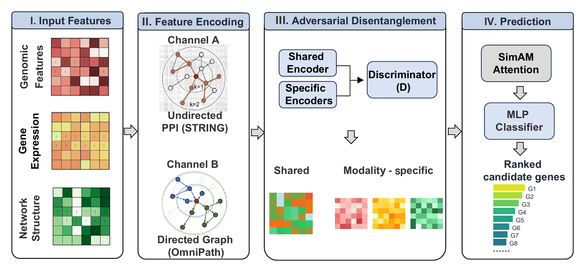

# DeepGene-AIID

**DeepGene-AIID** is a multimodal dual-channel graph neural network framework for prioritizing autoimmune and autoinflammatory disease-associated genes (AAGs) and dissecting shared pan-AIID functional modules.

[](https://www.python.org/)
[](https://pytorch.org/)
[](LICENSE)

---

## Overview

Autoimmune and autoinflammatory diseases (AIIDs) are clinically heterogeneous yet frequently co-occur and share underlying molecular mechanisms. **DeepGene-AIID** integrates genomic (GWAS), transcriptomic (17 blood-derived GEO cohorts, $n = 1,852$), and network structural modalities across **11,058 protein-coding genes** to prioritize candidate AAGs.

The framework combines:
1. **Dual-Channel Graph Encoding**: Weighted GraphSAGE and Directed Graph Convolutional Networks (DiGCN) to capture undirected and directed biological network topologies.
2. **Adversarial Representation Disentanglement**: Separates shared cross-modal consensus features from modality-specific representations (genomic-specific, expression-specific, and structure-specific).
3. **SimAM-Guided Feature Fusion**: Parameter-free attention mechanism to adaptively weight disentangled representations for final gene prioritization.

---

## Framework Architecture

<p align="center">
  
</p>

*Figure 1. Overall architecture of DeepGene-AIID, illustrating multimodal data integration across 17 AIID entities, dual-channel graph encoding, adversarial feature disentanglement, SimAM-guided fusion, and downstream translational and modular analyses.*

---

## Key Highlights

- **Benchmark Performance**: Achieved mean **AUROC = 0.928** and **AUPR = 0.846** in 5-fold cross-validation on a curated benchmark of 660 known AAGs and 1,000 putative negative genes, outperforming baseline models and single-channel variants.
- **Clinical Generalizability**: Transcriptomic gene-set scores derived from prioritized genes correlated with clinical phenotypes in independent systemic lupus erythematosus (SLE, `GSE121239`) and primary Sjögren’s syndrome (pSS, `GSE84844`) cohorts.
- **Novel Candidate Discovery**: Prioritized **110 candidate AAGs** (score > 0.95) outside the positive training set, yielding **93 novel candidate AAGs** after excluding 17 overlapping pharmacological reference targets.
- **Pan-AIID Modular Landscape**: Integrated known AAGs, pharmacological targets, and novel candidates into an **807-gene network** partitioned into **7 functional modules** spanning canonical autoimmune pathways, genomic maintenance, metabolic reprogramming/protein N-glycosylation, and neuroendocrine/GPCR signaling.

---

## Repository Structure

```text
DeepGene-AIID/
├── data/                   # Preprocessed multimodal features, PPI/directed networks, and labels
├── figures/                # Manuscript figures 
├── models/                 # Dual-channel encoder, disentanglement, and SimAM modules
├── scripts/                # Training, 5-fold CV evaluation, and downstream analysis scripts
├── results/                # Prioritized gene scores and module assignments
├── requirements.txt        # Python dependencies
└── README.md
